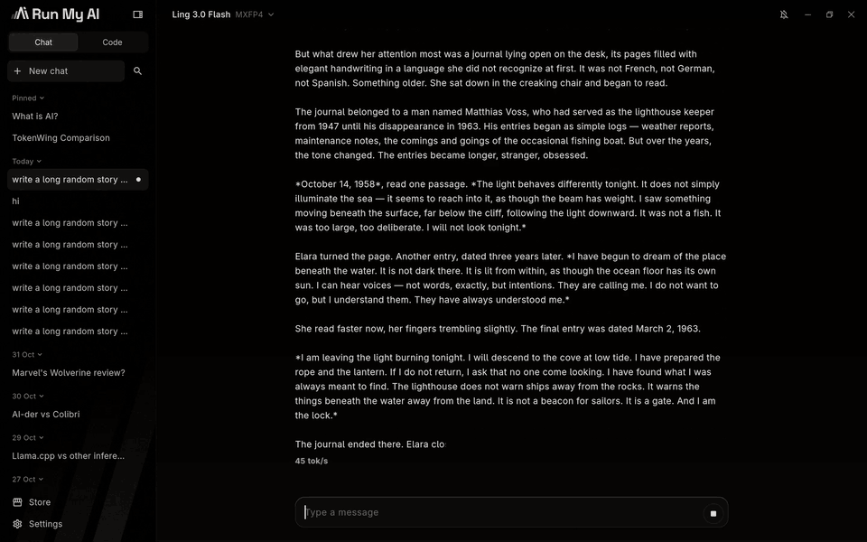

  

<b>The best local AI experience. Powered by <a href="https://github.com/runmyai/tokenwing">TokenWing</a>.</b>

  <a href="https://github.com/runmyai/run-my-ai/releases">Download</a> ·
  <a href="https://github.com/runmyai/run-my-ai">Star</a> ·
  <a href="https://discord.gg/BfpvUFp58">Discord</a> ·
  <a href="https://github.com/sponsors/HarinManiK">❤️ Sponsor</a>

<b>Download:</b> <a href="https://github.com/runmyai/run-my-ai/releases/latest/download/RunMyAI-windows-x64.exe">Windows</a> · <a href="https://github.com/runmyai/run-my-ai/releases/latest/download/RunMyAI-windows-arm64.exe">Windows on ARM</a> · <a href="https://github.com/runmyai/run-my-ai/releases/latest/download/RunMyAI-linux-x64.AppImage">Linux</a> · <a href="https://github.com/runmyai/run-my-ai/releases/latest/download/RunMyAI-linux-arm64.AppImage">Linux on ARM</a> · macOS coming soon

<b>Ling 3.0 Flash on a laptop</b> 124B parameters, MXFP4 and 262k context, on a laptop with a 12 GB GPU and 32 GB of RAM. The model file is 70 GB.

## The model you want. On the machine you have.

- **The model you want.** Big models, not a smaller stand-in, on the computer you already have.
- **Fast enough to use.** Speeds you can work with every day.
- **Private.** Everything runs on your machine. Nothing you type leaves it.
- **No limits, no bill.** No usage caps, no subscription. Free.

## What you can do

- **Pick a model from the store.** Downloads resume where they stopped, and the app tunes itself to your PC once a model is downloaded.
- **Chat, and branch a chat** from any earlier message. Old chats continue instantly: the engine's memory of each chat is saved on disk.
- **Benchmark your PC** on the Benchmark page.
- **Host a model for your own tools**, as an OpenAI-compatible API with an API key.
- **Stay up to date.** Updates download only the files that changed.

## Get it

Download the file for your system from [Releases](https://github.com/runmyai/run-my-ai/releases) and open it. Setup looks at your machine and suggests the engine build for it. You can change that choice. Then pick a model: once it is downloaded, the app tunes itself to your PC, and you can start chatting.

## Models

| Model | What it is | File |
|---|---|---|
| [Flint 40B](https://huggingface.co/runmyai/Flint-40B-TokenWing) | Coding model by Recursive. 40B total, about 2.5B active per token. | UD-Q4_K_XL, about 25 GB |
| [Ling 3.0 Flash](https://huggingface.co/runmyai/Ling-3.0-Flash-TokenWing) | 124B total, 5.1B active per token, 262k context, by Ant Group | MXFP4, about 70 GB |
| [Qwen 3.8 Flash Next](https://huggingface.co/runmyai/Qwen3.8-Flash-Next-TokenWing) | 180B total, 6B active per token, 262k context, by Alibaba | 3.5 bpw by Grawnch, about 84 GB with its n-gram table |

## Roadmap

- **macOS on Apple Silicon.**
- **Image and video input**, starting with Qwen 3.8 Flash Next.
- **More models.** Next: Inkling 2 Mini.

## FAQ

**Does it change the model's answers?**
No. Every expert the model picks is computed, with its full weights in the file's own quantization: no expert skipping, no top-k cut.

**Will it wear out my SSD?**
No. SSDs wear when they're written, not when they're read. Running a model only reads.

**Is it free?**
Yes. No usage caps, no subscription, and the code is open source under the MIT licence.

**Does it send anything?**
Your chats never leave your PC. If you leave "Share benchmark results and app stats" on (you can turn it off at first start or in Settings), the app and its engine each send a small anonymous record once a day: a random install id, the app and engine versions, the system, the processor and graphics cards, and the names of the models you downloaded. It also sends a note when a model or engine download finishes, and your Benchmark results when you run one. Once a day it asks runmyai.org whether a new version is out, sending only the app's version and system.

## Help with anything

Code, ideas, design, docs: improve or add whatever you'd like. See [Contributing](CONTRIBUTING.md).

## Build it yourself

[Building](docs/building.md) has the steps, and [App design](docs/app-design.md) explains how the code is put together.

## License

[MIT](LICENSE). The Run My AI and TokenWing names and logos are not part of the licence, so a fork needs its own name.
