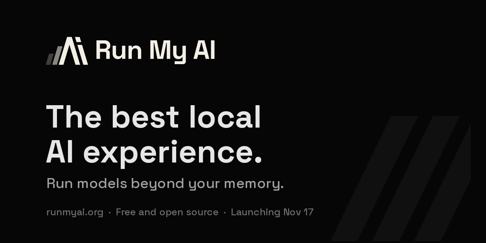

  

<b>The best local AI experience. Powered by <a href="https://github.com/runmyai/tokenwing">TokenWing</a>.</b>

  <a href="https://github.com/runmyai/run-my-ai/releases">Download</a> ·
  <a href="https://github.com/runmyai/run-my-ai">Star</a> ·
  <a href="https://discord.gg/BfpvUFp58">Discord</a> ·
  <a href="https://github.com/sponsors/HarinManiK">❤️ Sponsor</a>

<b>Download:</b> <a href="https://github.com/runmyai/run-my-ai/releases/latest/download/RunMyAI-windows-x64.exe">Windows</a> · <a href="https://github.com/runmyai/run-my-ai/releases/latest/download/RunMyAI-windows-arm64.exe">Windows on ARM</a> · <a href="https://github.com/runmyai/run-my-ai/releases/latest/download/RunMyAI-linux-x64.AppImage">Linux</a> · <a href="https://github.com/runmyai/run-my-ai/releases/latest/download/RunMyAI-linux-arm64.AppImage">Linux on ARM</a> · macOS coming soon

## The model you want. On the machine you have.

- **The model you want.** Big models, not a smaller stand-in, on the computer you already have.
- **Fast enough to use.** Speeds you can work with every day.
- **Private.** Everything runs on your machine. Nothing you type leaves it.
- **No limits, no bill.** No usage caps, no subscription. Free.

## Get it

Download the file for your system from [Releases](https://github.com/runmyai/run-my-ai/releases) and open it. Setup looks at your machine and suggests the engine build for it. You can change that choice. Then pick a model and run it.

## Models

| Model | What it is | File |
|---|---|---|
| Flint 40B | Coding model by Recursive. 40B total, about 2.5B active per token. | Q4_K_XL, about 25 GB |
| Ling 3.0 Flash | 124B total, 5.1B active per token, 262k context, by Ant Group | MXFP4, about 70 GB |
| [Qwen 3.8 Flash Next](https://huggingface.co/runmyai/Qwen3.8-Flash-Next-TokenWing) | 180B total, 6B active per token, 262k context, by Alibaba. | 3.5 bpw by Grawnch, about 84 GB with its n-gram table |

## FAQ

**Does it change the model's answers?**
No. Every expert the model picks is computed, with its full weights in the file's own quantization: no expert skipping, no top-k cut.

**Will it wear out my SSD?**
No. SSDs wear when they're written, not when they're read. Running a model only reads.

## Help with anything

Code, ideas, design, docs: improve or add whatever you'd like. See [Contributing](CONTRIBUTING.md).

## Build it yourself

[Building](docs/building.md) has the steps, and [App design](docs/app-design.md) explains how the code is put together.

## License

[MIT](LICENSE). The Run My AI and TokenWing names and logos are not part of the licence, so a fork needs its own name.
